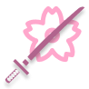

# Sakura Framework

[](https://www.nuget.org/packages/Sakura.Framework/)

A graphic framework and set of toolkits for making basic UI application and 2D game (right now) target to support as many platforms as possible. Backed by .NET.

## Use this framework

Use our template to quickly create a new project

```shell
dotnet new install Sakura.Framework.Templates
dotnet new sakura -n MyAwesomeGame

# with an Android project as well (needs the .NET Android workload, see "Run on Android")
dotnet new sakura -n MyAwesomeGame --android
```

See [sample app repository](https://github.com/HelloYeew/sakura-sample-app) for example.

## Documentation

Some incomplete documentation is in [wiki](https://github.com/HelloYeew/sakura/wiki), or the API reference you can check [the API reference site](https://helloyeew.github.io/sakura-api-docs).

## Requirements

- .NET 11.0 SDK
- We recommend to use IDE like [Visual Studio](https://visualstudio.microsoft.com/vs/), [Rider](https://www.jetbrains.com/rider/) or [VS Code](https://code.visualstudio.com/) for development with this framework

### Issue of native library when using Windows ARM64

On Windows ARM64, the BASS audio library (`bass.dll`) requires the **Visual C++ Redistributable for ARM64**. Without it you will see:

```
Unable to load DLL 'bass' or one of its dependencies: The specified module could not be found. (0x8007007E)
```

Also our SPIRV library (`libsakura-spirv`) also depend on it too

```
Unable to load DLL 'libsakura-spirv' or one of its dependencies: The specified module could not be found. (0x8007007E)
```

So we fix these problem by pack `vcruntime140.dll` for BASS and `msvcp140.dll` for SPIRV in our native library package. But if the problem still occured please install the VC++ Redistributable for ARM64 [https://aka.ms/vs/17/release/vc_redist.arm64.exe](https://aka.ms/vs/17/release/vc_redist.arm64.exe)

On release, running as x64 (via Windows ARM64's x64 emulation layer) avoids this issue entirely since the x64 `bass.dll` does not depend on the VC++ Redistributable. Most shipped games/apps targeting Windows ARM64 use this approach.

## Quick start

```shell
git clone https://github.com/HelloYeew/sakura
cd sakura
dotnet restore

# Run visual test
cd Sakura.Framework.Tests
dotnet run
```

### Building native libraries manually

If you need to rebuild a native library :

**FFmpeg:**
```shell
# macOS
bash Sakura.Framework.NativeLibraries/script/ffmpeg/build-macos.sh

# Android (requires ANDROID_NDK_ROOT set)
bash Sakura.Framework.NativeLibraries/script/ffmpeg/build-android.sh

# iOS (requires gas-preprocessor)
bash Sakura.Framework.NativeLibraries/script/ffmpeg/build-iOS.sh
```

### Test Vulkan on macOS

Metal is the backend on macOS, so Vulkan is never listed there and is never chosen automatically. You can still run the Vulkan renderer on a Mac to develop it, through [KosmicKrisp](https://www.lunarg.com/products/kosmickrisp/), the conformant Vulkan-on-Metal driver that ships with the LunarG Vulkan SDK (Apple Silicon only).

1. Download the [LunarG Vulkan SDK for macOS](https://vulkan.lunarg.com/sdk/home#mac) and install its core component. No `sudo` is needed, and nothing is copied into `/usr/local`:

   ```shell
   # from the folder the SDK zip was extracted to (1.4.363.0 is the version this was tested with)
   ./vulkansdk-macOS-1.4.363.0.app/Contents/MacOS/vulkansdk-macOS-1.4.363.0 \
     --root ~/VulkanSDK/1.4.363.0 --accept-licenses --default-answer \
     --confirm-command install com.lunarg.vulkan.core
   ```

2. Point the Vulkan loader at KosmicKrisp in the shell you run the app from:

   ```shell
   source ~/VulkanSDK/1.4.363.0/setup-env.sh

   # setup-env.sh enables both drivers in the SDK (KosmicKrisp and MoltenVK). Keep only KosmicKrisp.
   export VK_DRIVER_FILES="$VULKAN_SDK/share/vulkan/icd.d/libkosmickrisp_icd.json"

   # Points SDL and the renderer at the SDK's loader. setup-env.sh does this through DYLD_LIBRARY_PATH,
   # which macOS strips whenever a protected program (anything in /usr/bin, such as env or perl)
   # launches the app; this variable survives that.
   export SDL_VULKAN_LIBRARY="$VULKAN_SDK/lib/libvulkan.1.dylib"

   vulkaninfo --summary   # GPU0 should show driverName = KosmicKrisp
   ```

   Without these variables SDL can't find the Vulkan loader (`Failed to load Vulkan Portability library`), or finds it without a driver (`doesn't implement the VK_KHR_surface extension`), and the app logs that Vulkan is unavailable and falls back to Metal. When running from Rider, set `SDL_VULKAN_LIBRARY`, `VK_DRIVER_FILES` and `VK_ADD_LAYER_PATH` to the same values in the run configuration's environment variables.

3. Select Vulkan in the app's `framework.ini`. For the sample app that is `~/Library/Application Support/sample-app/framework.ini`:

   ```ini
   RendererType = Vulkan
   ```

   The log then shows `Vulkan device: …, driver: KosmicKrisp …` and the swapchain it created.

Debug builds turn on the Khronos validation layer (with synchronization validation) whenever it is installed, and report every message in the log and in the `Vulkan › Validation Messages` statistic. Two environment variables change the defaults:

| Variable | Effect |
|---|---|
| `SAKURA_VULKAN_VALIDATION` | `1` turns validation on in a release build, `0` turns it off in a debug build |
| `SAKURA_VULKAN_DEVICE` | Uses the device or driver whose name contains this text, e.g. `MoltenVK` to test MoltenVK while both drivers are enabled |
| `SAKURA_VULKAN_MAX_FRAME_LATENCY` | Under VSync, waits until at most this many presents are still on their way to the screen before starting a frame (`0` waits for the previous frame to be on screen). Unset, nothing waits. For comparing latency (`Vulkan › Present Latency`) and frame rate with and without it; needs `VK_KHR_present_wait` |

The Vulkan tests (the Vulkan runs of `BufferedContainerCompositeTest` and `FrameBufferCompositeBlendTest`, `VulkanAllocationTest`, `VulkanVideoTest` and `VulkanZeroCopyTest`) render offscreen and run with `dotnet test` in a shell with the variables from step 2 set. Without a Vulkan driver they're skipped, and any validation message fails them. `VulkanZeroCopyTest` also needs an FFmpeg built with Vulkan, which the macOS native libraries aren't, so it's skipped there. CI runs them on Linux on Mesa's software driver, along with a test that drives a real window under Xvfb.

### Run on Android

Android runs the Vulkan renderer on .NET's CoreCLR runtime. Apps need Android 10 (API 29) or later on an arm64 phone or tablet with Vulkan 1.1. The build warns that CoreCLR on Android is experimental (`XA1040`); that's expected.

You need:

- The .NET Android workload: `dotnet workload install android` (with `sudo` where .NET is installed system-wide, as on macOS)
- JDK 21, e.g. `brew install openjdk@21`
- The Android SDK, from [Android Studio](https://developer.android.com/studio) or its command-line tools, with `platform-tools` (for `adb`)
- A phone with USB debugging on, or an emulator. Use an arm64 **API 35** system image: the API 36 image's Vulkan driver is broken. The emulator's graphics are emulated, so measure performance on a phone

When the build can't find the JDK or the SDK by itself (Homebrew's JDK isn't registered with `java_home`), pass them to every `dotnet build` below:

```shell
-p:JavaSdkDirectory=/opt/homebrew/opt/openjdk@21/libexec/openjdk.jdk/Contents/Home -p:AndroidSdkDirectory=$HOME/Library/Android/sdk
```

**Debug** builds install and start the app on the connected phone or emulator. They deploy the assemblies beside the APK, so the APK on its own won't run; always deploy through the build:

```shell
dotnet build SampleApp.Android -t:Run       # install and start
dotnet build SampleApp.Android -t:Install   # install only
```

**Release** builds make a self-contained APK (trimmed, assemblies inside), signed with the debug key:

```shell
dotnet build SampleApp.Android -c Release
adb install -r SampleApp.Android/bin/Release/net11.0-android/dev.helloyeew.sakura.sampleapp-Signed.apk
```

`adb install -r` replaces the app and keeps its data. Debug and Release builds are both signed with the debug key, so either can replace the other; don't `adb uninstall` an app whose data you want to keep. To publish to a store, sign with your own key (`AndroidKeyStore`, `AndroidSigningKeyStore`, `AndroidSigningKeyAlias` and the passwords) and build an `.aab` (`-p:AndroidPackageFormats=aab`).

The visual test browser runs on a phone too: `dotnet build Sakura.Framework.Tests.Android -t:Run`.

The log goes to logcat, tagged with the activity's `AppName` (the package name unless overridden), so `adb logcat -s dev.helloyeew.sakura.sampleapp` shows the sample's. Debug builds log at debug level, Release builds at verbose. A phone has no Ctrl+F keys: in a Debug build, a four-finger tap opens a menu of the debug tools (frame graph, draw visualiser, statistics, textures, audio mixer, log and the rest).

A new app gets an Android project from the template with `dotnet new sakura -n MyAwesomeGame --android`.

## Contributing

Contributing via pull requests, suggestions, or bug reports via issues is welcome.

## Source Generator

Some part of this framework generated by [source generator](https://devblogs.microsoft.com/dotnet/introducing-c-source-generators/) to reduce boilerplate code.

See wiki for more detail.

For reference on the generated code, see the [generated source repository](https://github.com/HelloYeew/sakura-generated-source).

## License

This project is licensed under the MIT license. Please see [the license file](LICENSE) for more information. tl;dr you can do whatever you want as long as you include the original copyright and license notice in any copy of the software/source.

The fonts used as the default font in this framework are licensed under [SIL Open Font License 1.1](https://openfontlicense.org).
